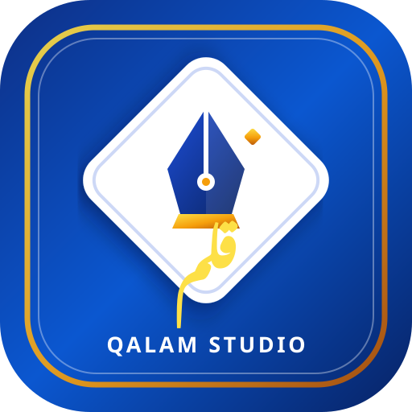
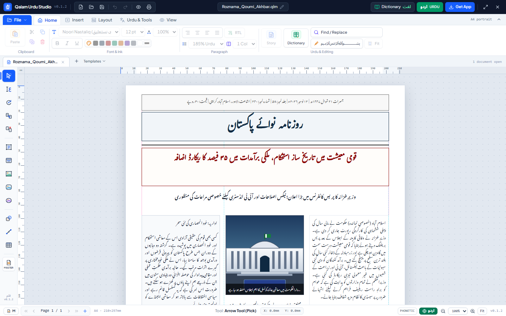

<div align="center">



# Qalam Urdu Studio

**Desktop publishing for Urdu Nastaliq, Arabic and English**

Created by **Uzair Asad**

[Website](https://uzairasad.github.io/qalam-urdu-studio/) ·
[Open in your browser](https://uzairasad.github.io/qalam-urdu-studio/app/) ·
[Download](https://github.com/uzairasad/qalam-urdu-studio/releases/latest) ·
[Changelog](CHANGELOG.md)

[](LICENSE)
[](https://github.com/uzairasad/qalam-urdu-studio/actions/workflows/ci.yml)

</div>



Qalam Urdu Studio lets you typeset newspapers, magazines, books and documents in Urdu
Nastaliq, then print them or export to PDF and Word. It runs as a native app on Windows, macOS,
Linux and Android, and in any modern browser.

## Features

- **True Nastaliq.** Noto Nastaliq Urdu, Gulzar, Naskh, Ruqaa, Kufi and Quranic fonts, all
  bundled, with correct joining and right-to-left layout.
- **Urdu keyboards.** Phonetic, Monotype and Muqtadira layouts and an on-screen keyboard, so you
  can type Urdu on any computer without changing system settings.
- **Page layout.** Multi-column text frames, picture boxes, tables, master pages, rulers, a snap
  grid and character scaling, on real paper sizes.
- **Urdu dictionary.** Meanings, synonyms and antonyms, available offline.
- **Open and export.** Qalam documents (`.qlm`); open Word, PDF and text files; export PDF,
  Word, PNG, HTML and Unicode text.
- **Opens old InPage files.** Documents from InPage 1.x, 2.x, 2000, XP 2004 and 2005 (`.inp`,
  the `.B01` backups next to them, and InPage text exports) open as Unicode Urdu, ready to
  edit and re-typeset: the text and paragraphs come across; the original page layout doesn't
  yet. **Export for InPage 2000–2005** writes text the other way, in InPage's own encoding,
  for File → Import in old InPage.
- **Print-ready.** Print preview and native printing at the exact physical page size.
- **Works offline.** Nothing is loaded from the internet once the app is installed.
- **Updates itself.** The desktop apps install signed updates in place (File → About → Check for
  updates, or a quiet check at start-up at most once a day, which you can turn off).
- **Fits any screen.** At 150–200% display scaling or in short windows the window fits the
  screen and the ribbon goes compact, so the page keeps the room.

## Download

Get the latest version from the [releases page](https://github.com/uzairasad/qalam-urdu-studio/releases/latest).
Every file is listed with its SHA-256 checksum in `SHA256SUMS.txt`.

| Platform | File | Notes |
| --- | --- | --- |
| Windows 10/11 | `_x64-setup.exe`, `_x64_en-US.msi`, `-portable-windows-x64.zip` | If SmartScreen warns, choose More info → Run anyway. |
| macOS 10.15+ | `_aarch64.dmg` (Apple Silicon), `_x64.dmg` (Intel) | First launch: right-click the app → Open. |
| Linux | `.AppImage`, `.deb`, `.rpm` | Needs WebKitGTK 4.1 (Ubuntu 22.04+, Debian 12+, Fedora 37+). |
| Android | `-android-arm64.apk` | Signed release build for 64-bit phones and tablets. |
| Web | [Open in your browser](https://uzairasad.github.io/qalam-urdu-studio/app/) | Install it as an app from the browser, or download the single-file offline version from inside it. |

The Windows and macOS builds aren't code-signed yet, which is why those warnings appear. See
[docs/SIGNING.md](docs/SIGNING.md).

## How it's built

Urdu Nastaliq is one of the hardest scripts to render: letters join along a sloping baseline,
change shape with their neighbours, and run right to left alongside left-to-right numbers and
English. Operating systems already ship text engines that do this well (DirectWrite, Core Text
and HarfBuzz), and the system web engine is the most direct way to use them on every platform.
So Qalam is built in layers:

```
┌────────────────────────────────────────────────────────────────────┐
│  Editor — React + TypeScript (src/)                                │
│  page canvas, text frames, ribbon, keyboards, dictionary,          │
│  import / export (PDF, Word, PNG, HTML, text)                      │
├────────────────────────────────────────────────────────────────────┤
│  Platform bridge — src/platform/native.ts                          │
│  save, print, open-with: native calls in the app,                  │
│  browser downloads and window.print() on the web                   │
├───────────────────────────────────┬────────────────────────────────┤
│  Native shell — Rust, Tauri 2     │  Web — PWA with offline cache  │
│  (src-tauri/)                     │  + single-file offline HTML    │
│  windows, Save dialogs that write │                                │
│  real files, native printing,     │                                │
│  .qlm file associations, one      │                                │
│  running instance                 │                                │
├───────────────────────────────────┴────────────────────────────────┤
│  System web engine: WebView2 · WKWebView · WebKitGTK · Android     │
└────────────────────────────────────────────────────────────────────┘
```

- **One codebase.** The editor doesn't know where it runs. Everything platform-specific goes
  through `src/platform/native.ts`, which calls the Rust shell inside the app and falls back to
  browser behaviour on the web.
- **Small, native apps.** The Rust shell uses the web engine the system already has, so
  most installers are about 6 MB. It adds what a browser tab can't do: Save dialogs that remember
  the last folder, native printing, double-click to open `.qlm` files, and handing documents to
  the already-running window.
- **Restricted file access.** The editor can only read files the user opened through the OS, and
  can only write where the user chooses in a Save dialog.
- **Updates.** The desktop apps use Tauri's updater: they read `latest.json` from the latest
  GitHub release, check the download's signature against the key built into the app, install
  it and restart. Portable and .deb/.rpm copies, and the Android app, are sent to the download
  page instead; the web app updates itself. The check only asks GitHub for the latest release.
- **Reading InPage.** A `.inp` file is an OLE compound file; Qalam reads it with a small
  built-in reader (`src/utils/ole.ts`), finds the paragraph records in its `InPage100`
  stream, and maps InPage's two-byte character codes to Unicode (`src/utils/inpageText.ts`),
  fixing the format's quirks: numbers stored reversed, ے used for medial ی, one code for ئ and
  ء, and letters stored as letter + hamza or madda.
- **Fonts included.** All typesetting fonts are bundled (`src/fonts.css`), so pages look the
  same everywhere and work with no network connection.

### Repository layout

```
src/                  the editor (React + TypeScript)
  components/         ribbon, canvas, toolbox, dialogs
  utils/              import/export, keyboards, dictionary, templates
  platform/native.ts  bridge to the native shell
src-tauri/            Rust shell (Tauri 2): src/lib.rs, tauri.conf.json, icons
public/               web app icons
site/                 GitHub Pages project page
scripts/              build helpers (single-file offline build, font trimming)
docs/                 SIGNING.md: release signing
LICENSE               GPL-3.0 text; THIRD-PARTY-NOTICES.md lists fonts and libraries
.github/workflows/    ci.yml, release.yml, pages.yml
```

## Develop

You need Node 22+, Rust (stable, via [rustup](https://rustup.rs)), and the
[Tauri prerequisites](https://tauri.app/start/prerequisites/) for your OS. On Windows that means
the "Desktop development with C++" build tools; WebView2 already comes with Windows 10/11.

```bash
npm install
npm run app:dev      # native app with hot reload
npm run app:build    # installers in target/release/bundle/
npm run dev          # web app only, http://localhost:3000
npm run build        # web app (dist/) + single-file offline HTML
npm run lint         # TypeScript type check
npm test             # unit tests (node --test)
```

Rust checks: `cargo fmt --all`, `cargo clippy --workspace --all-targets -- -D warnings`,
`cargo test --workspace`.

## Releasing

1. Set the new version in `package.json` (the installers read it from there) and in
   `Cargo.toml` under `[workspace.package]`, and add it to `CHANGELOG.md`.
2. Commit, then tag and push, for example `git tag v0.2.0 && git push origin main v0.2.0`.
3. `.github/workflows/release.yml` builds every platform on GitHub Actions, signs the Android
   app, attaches `SHA256SUMS.txt` and publishes the release. The website's download buttons pick
   up the new files automatically.

Pushing to `main` also rebuilds the website and the web app (`.github/workflows/pages.yml`).

## License

Qalam Urdu Studio is created by **Uzair Asad** and is free and open-source software, licensed
under the [GNU General Public License v3.0 or later](LICENSE). You can use it for anything,
including commercial work, study and change the source, and share it. Any version you
distribute, changed or not, must stay under the same license, with its source available and
its credits kept. Documents you make with the app are entirely yours.

The bundled fonts are under the SIL Open Font License 1.1, and the libraries under their own
permissive licenses: see [THIRD-PARTY-NOTICES.md](THIRD-PARTY-NOTICES.md).

© 2026 Uzair Asad
